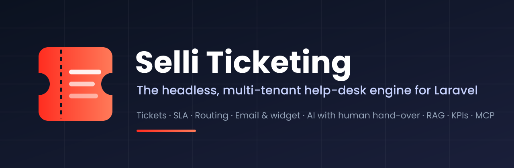

<p align="center">
  
</p>

# Selli Ticketing

[](https://packagist.org/packages/selli/ticketing)
[](https://github.com/Sellinnate/laravel-ticket-engine/actions/workflows/run-tests.yml?query=branch%3Amain)
[](https://github.com/Sellinnate/laravel-ticket-engine/actions/workflows/coverage.yml?query=branch%3Amain)
[](https://github.com/Sellinnate/laravel-ticket-engine/actions/workflows/phpstan.yml?query=branch%3Amain)
[](https://packagist.org/packages/selli/ticketing)
[](https://packagist.org/packages/selli/ticketing)
[](LICENSE.md)
[](https://laravel-ticketing.selli.io)

📖 **Full documentation: [laravel-ticketing.selli.io](https://laravel-ticketing.selli.io)**

**The headless, multi-tenant help-desk engine for Laravel.** Tickets about anything in your app — an order,
a device, a contract, or nothing at all — with the workflow, SLA, routing, channels, AI and reporting a
support team needs, and no UI or product decisions imposed on you.

> **An engine, not an app.** `selli/ticketing` is the domain layer you build customer support, technical
> interventions, internal requests or incident management on. The same engine serves a Filament
> back-office, an Inertia/Vue front-end, a mobile API, a chat widget on a customer's website or an AI agent.

### What you can build

- 🎫 **A help desk inside your product** — tickets attached to your own models, your users as requesters
  and agents, every tenant isolated.
- 💬 **A chat widget on any website** that answers with AI from your knowledge base and hands over to a
  person — the conversation becomes a ticket with its transcript.
- 📧 **Email support** — by webhook or IMAP, threaded, without quotes, autoresponders or loops.
- 🤖 **An AI first line** that answers with sources, drafts for agents, classifies, and escalates by rule;
  agents take over at any moment.
- 📊 **Support KPIs** — volume, backlog, response and resolution times, SLA, AI share and cost, CSAT,
  unanswered questions — with streamed CSV exports.
- 🧠 **AI agents on your help desk** through MCP tools that obey your policies.

## Features

| Area | Highlights |
| --- | --- |
| **Core** | Tickets on any model (`Ticketable`), config-driven [workflow](https://laravel-ticketing.selli.io/concepts/workflow) per type with guards, custom fields, references, [listing & filtering](https://laravel-ticketing.selli.io/concepts/querying) (`TicketQuery`) |
| **Operations** | [SLA on business hours](https://laravel-ticketing.selli.io/concepts/sla), [routing & assignment](https://laravel-ticketing.selli.io/concepts/routing) (round-robin, least-busy, skill-based), [collaboration](https://laravel-ticketing.selli.io/concepts/collaboration) (attachments, mentions, macros, merge/split, tags), [automation](https://laravel-ticketing.selli.io/concepts/automation) and webhooks, [notifications](https://laravel-ticketing.selli.io/concepts/notifications), [CSAT](https://laravel-ticketing.selli.io/concepts/csat) |
| **People** | Your models as requesters/agents, [contacts](https://laravel-ticketing.selli.io/concepts/contacts) for people without an account, reopen on requester reply |
| **Channels** | [REST API](https://laravel-ticketing.selli.io/channels/rest-api), [email](https://laravel-ticketing.selli.io/channels/email) (webhook or IMAP), [chat widget](https://laravel-ticketing.selli.io/channels/widget) with a reference JS client, [broadcasting](https://laravel-ticketing.selli.io/channels/broadcasting) |
| **AI** | Provider-agnostic [AI layer](https://laravel-ticketing.selli.io/concepts/ai): auto / draft / off per tenant and type, escalation rules, human takeover, usage and cost per turn |
| **Knowledge** | [Knowledge base](https://laravel-ticketing.selli.io/concepts/knowledge-base): articles and FAQs, versions, locales, audiences (public, customer, internal, per client) |
| **Insight** | [KPIs and CSV exports](https://laravel-ticketing.selli.io/concepts/reporting), in the database, at any volume |
| **Integrations** | [MCP tools](https://laravel-ticketing.selli.io/integrations/mcp) (`laravel/mcp`), [RAG Engine bridge](https://laravel-ticketing.selli.io/integrations/rag-engine) (`sellinnate/rag-engine`): semantic search, answers with citations, similar tickets |
| **Security** | Fail-closed [multi-tenancy](https://laravel-ticketing.selli.io/concepts/tenancy), [policies](https://laravel-ticketing.selli.io/security/authorization), immutable [audit trail](https://laravel-ticketing.selli.io/security/audit-trail), [GDPR](https://laravel-ticketing.selli.io/security/gdpr) erasure / export / retention |

## Installation

```bash
composer require selli/ticketing
php artisan ticketing:install   # publishes config + migrations, offers to migrate
php artisan ticketing:demo      # seeds a working example ticket
```

Requires PHP 8.3+ and Laravel 11, 12 or 13. Tested on MySQL 8.4, PostgreSQL 16 and SQLite (its SQL avoids
vendor-specific constructs, SQL Server included).

## Quick start

```php
use Selli\Ticketing\Concerns\HasTickets;
use Selli\Ticketing\Contracts\Ticketable;

class Order extends Model implements Ticketable
{
    use HasTickets; // tickets() relation + openTicket() helper
}
```

```php
use Selli\Ticketing\Facades\Ticketing;
use Selli\Ticketing\Enums\{MessageVisibility, Priority};

$ticket = $order->openTicket(type: 'support', title: 'Missing shipment', requester: $customer, priority: Priority::High);

Ticketing::for($ticket)->postMessage($agent, 'Checking with the courier', MessageVisibility::Internal);
Ticketing::for($ticket)->postMessage($agent, 'A new parcel leaves today.');
Ticketing::transition($ticket, 'resolve', $agent);

$open = Ticketing::tickets()->state('open')->assignedTo($agent)->sort('priority')->paginate();
$kpis = Ticketing::metrics()->between(now()->subMonth(), now())->summary();
```

Actors are agnostic: implement `CanRequestTickets` and/or `CanActOnTickets` on whichever models represent
your requesters and agents (even two different populations such as `Customer` and `Operator`).

## Multi-tenancy

Every table carries a tenant column, every read goes through a global scope, every write is assigned to the
current tenant, and with no tenant resolved the scope **fails closed**. Bind your own `TenantResolver` to
reuse stancl/tenancy, spatie/laravel-multitenancy or your own; act as a tenant in CLI and queues with
`TenantContext::forTenant()`.

## AI, with humans in charge

```php
// config/ticketing.php
'ai' => ['enabled' => true, 'driver' => 'rag-engine', 'mode' => 'auto'],
```

The AI answers customers from what they may read, with sources; it hands over — to the routing rules, then
the escalation team, notifying its leads — when it is unsure, finds nothing, meets a sensitive topic, or the
customer asks for a person. The moment an agent replies, it steps aside for good. Drivers are pluggable:
`null`, `fake` for tests, `rag-engine`, or your own.

## Stability

`1.x` follows [semantic versioning](https://laravel-ticketing.selli.io/reference/versioning): the
[public API](https://laravel-ticketing.selli.io/reference/public-api) — facade, actions, contracts, events,
models and tables, config keys, REST routes, commands — never breaks within `1.x`; migrations are only ever
added. See [UPGRADE.md](UPGRADE.md).

## Testing

```bash
composer test            # Pest (TICKETING_TEST_DB=mysql|pgsql for a real database)
composer test-coverage   # with the 90 % minimum
composer analyse         # PHPStan (Larastan) level 8
composer format          # Laravel Pint
```

CI runs PHP 8.3–8.5 × Laravel 11–13 (lowest and stable dependencies) on Linux and Windows, the whole suite
on MySQL 8.4 and PostgreSQL 16, coverage, static analysis and the widget client tests.

## Changelog, upgrading, contributing

- [CHANGELOG](CHANGELOG.md) — what changed in each release.
- [UPGRADE.md](UPGRADE.md) — how to move between versions.
- [CONTRIBUTING.md](CONTRIBUTING.md) — setup and quality gates.

## Security

Please report vulnerabilities privately — see [SECURITY.md](SECURITY.md).

## Credits

- [Sellinnate](https://github.com/Sellinnate)
- [All Contributors](https://github.com/Sellinnate/laravel-ticket-engine/graphs/contributors)

## License

The MIT License (MIT). Please see [License File](LICENSE.md) for more information.
